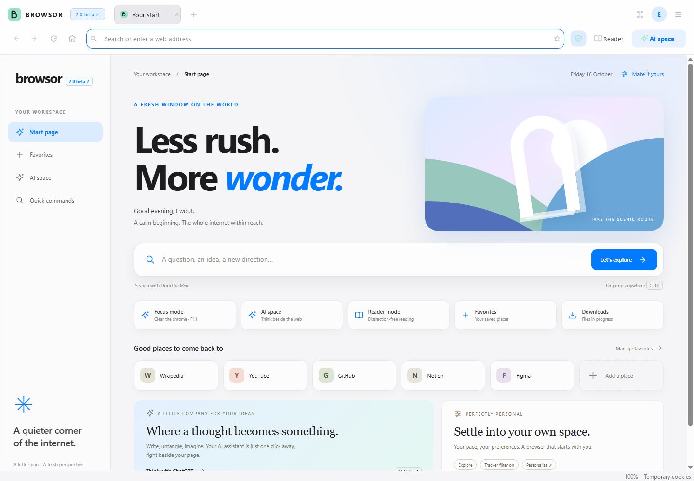

# BROWSOR · 2.0 beta 2

**Your space. For what's next.**

A personal desktop browser with a calm start page, local preferences and an AI workspace beside the web. Built with Python, PySide6 and Qt WebEngine.

[Download the beta for Windows or macOS](https://github.com/WALDEX451/BROWSOR/releases/tag/v2.0.0-beta.2) · [What's new](CHANGELOG.md) · [Report an issue](https://github.com/WALDEX451/BROWSOR/issues)



## Try version 2.0 from source

Version 2.0 beta 2 introduces an Apple-inspired light workspace: translucent surfaces, system-blue accents, rounded cards, quick actions and a distraction-free Reader mode. Existing profiles retain their settings; choose Blue in preferences for the new default accent.

Run `pip install -r requirements.txt`, then `python main.py`. To regenerate the real-app preview and run layout/tab smoke checks on Windows, run `python scripts/preview_v2.py`. Local Windows packages are in `dist/`: `BROWSOR-2.0.0-beta.2-windows-x64-setup.exe` and `BROWSOR-2.0.0-beta.2-windows-x64.zip`. The setup installs for the current user. The executable is unsigned and this beta has no automatic updater. DuckDuckGo is the default search engine, with live smoke checks in `python scripts/check_duckduckgo.py`.

## Get started on Windows

1. Download **BROWSOR-2.0.0-beta.2-windows-x64-setup.exe** from the release page.
2. Run the installer. It installs for your Windows account and creates a Start menu shortcut; a desktop shortcut is optional.
3. Open **BROWSOR Beta**. Python is included; no separate Python installation is needed.
4. Choose your name, browsing purpose, search engine, AI assistant, accent color and what BROWSOR remembers.

Prefer a portable folder? **BROWSOR-2.0.0-beta.2-windows-x64.zip** is also available. Extract the entire ZIP and keep `BROWSOR.exe` and `_internal` together.

Setup is shown until you save it, then remembered. Reopen your preferences anytime with **Ctrl+,**. Website sign-in storage changes take effect after restarting.

This is **2.0.0-beta.2**. The Windows executable is unsigned, so Windows may show an unknown-publisher warning. There is no automatic updater. See [beta limitations](CHANGELOG.md#beta-limitations) before relying on it as your everyday browser.

## Get started on macOS

Requires macOS 13 or later. Choose the file that matches your Mac:

| Mac | Download |
| --- | --- |
| Apple Silicon (M1, M2, M3, M4 and later) | `BROWSOR-2.0.0-beta.2-macos-arm64.dmg` |
| Intel | `BROWSOR-2.0.0-beta.2-macos-x86_64.dmg` |

Open the DMG, drag **BROWSOR.app** to **Applications**, then open BROWSOR from Applications. Python and Qt are included. The Mac builds use an ad-hoc signature; they are **not Apple Developer ID signed or notarized**. macOS may block the first launch. After trying to open the downloaded app, review **System Settings → Privacy & Security → Open Anyway** if you trust that copy. Do not disable Gatekeeper.

The download page includes `INSTALLERS-SHA256SUMS.txt` for the EXE and both DMGs. The older `SHA256SUMS.txt` covers the portable ZIP. See [installer details](INSTALLERS.md) for provenance and startup checks.

## A connected workspace

- **Your own start page.** Local artwork, personalized greeting, search, five favorite shortcuts and three accent colors. Nothing on the start page needs a remote asset.
- **Go anywhere, quickly.** Press **Ctrl+K** to find an open tab, jump to a favorite, run an action or search the web. Suggestions use local tabs and favorites.
- **AI beside your page.** Choose Gemini, ChatGPT, Claude, Copilot or Perplexity. Open, resize, reload or move the assistant into a tab. Copy page context when you want to share a title, address or selected text.
- **Favorites you can take with you.** Add, edit, reorder, import and export. HTML works with other browsers; JSON is available for BROWSOR backups. Imports flatten folders and keep up to 100 unique valid addresses.
- **Choose what stays.** Saved preferences and favorites; optional website sign-ins; optional restoration of up to 20 tabs after a normal close.
- **Everyday tools.** Movable tabs, reopen closed tabs, downloads with progress and cancellation, find on page, zoom and fullscreen.
- **Reader mode.** Press **Ctrl+Shift+R** on a website to remove navigation clutter and read the main content in a calm, responsive layout.

## Keyboard shortcuts

| Action | Shortcut |
| --- | --- |
| Go anywhere | Ctrl+K |
| Address bar | Ctrl+L |
| New / close tab | Ctrl+T / Ctrl+W |
| Reopen closed tab | Ctrl+Shift+T |
| Next / previous tab | Ctrl+Tab / Ctrl+Shift+Tab |
| Switch to tab 1–8 / last tab | Ctrl+1–8 / Ctrl+9 |
| AI space | Ctrl+Shift+A |
| Reader mode | Ctrl+Shift+R |
| Save favorite / manage favorites | Ctrl+D / Ctrl+Shift+B |
| Find on page / downloads | Ctrl+F / Ctrl+J |
| Preferences | Ctrl+, |
| Zoom in / out / reset | Ctrl++ / Ctrl+- / Ctrl+0 |
| Back / forward / start page | Alt+Left / Alt+Right / Alt+Home |
| Reload / fullscreen | Ctrl+R / F11 |

## Accounts and local storage

BROWSOR has a **local account**, not a cloud account. On first launch, the account setup lets you choose your name, browsing purpose and start-page message. The other two setup pages control search, AI, tab restoration, start-page density, accent color, tracker protection and saved website sign-ins. Open **Ctrl+,** whenever you want to change any of these settings. It does not provide its own Google/Apple login or synchronization. Sign in on the website of the service you use. Some providers reject embedded-browser sign-ins; those restrictions are not bypassed.

By default, website cookies and the HTTP cache stay in memory. Enable **Stay signed in to websites** to save website data in the Qt profile. The choice takes effect after a restart. Turning it off starts a temporary session but does not delete an older saved profile.

Profile preferences, favorites, setup completion and window size are saved locally. On Windows these settings use `HKEY_CURRENT_USER\Software\BROWSOR\BROWSOR`. When enabled, tab restoration also saves tab URLs there. Persistent website storage is under `%LOCALAPPDATA%\BROWSOR\BROWSOR\web-profile`. Moving the portable application folder does not move these settings. Downloads stay in the location you choose.

The tracker filter blocks a limited list of third-party domains. It is not anonymity protection. Searches are sent to your selected search engine. AI services process the content you send according to their terms. **Copy page context** puts the title, URL and up to 12,000 selected characters on the clipboard; it does not automatically send them to an AI service.

## Run from source

Use Python 3.12 on Windows for the release configuration:

```powershell
py -3.12 -m venv .venv
.\.venv\Scripts\python.exe -m pip install -r requirements.txt
.\.venv\Scripts\python.exe main.py
```

The start page and icons under `assets/` are required. Run `python main.py --version` for the version string.

## Build the Windows package

```powershell
.\.venv\Scripts\python.exe -m pip install -r requirements-build.txt
.\.venv\Scripts\python.exe scripts/build_windows.py
```

The build produces a folder, ZIP and `SHA256SUMS.txt` in `dist/`. It bundles dynamic Qt libraries, WebEngine resources, a Windows icon, version metadata and dependency notices. It does not sign the executable. Use a clean environment with 64-bit Python; build outputs are ignored by Git.

To make the installation EXE, compile `scripts/windows-installer.iss` with Inno Setup 6 or later and pass `/DSourceRoot=` followed by this checkout's absolute path. For macOS, run `python scripts/build_macos.py` **on a Mac**, using Python 3.12 and `requirements-build.txt`; it produces a DMG for the machine's native architecture.

The GitHub **Build beta installers** workflow builds on Windows, Apple Silicon and Intel Mac runners, checks packaged startup, and adds assets to the existing beta without moving its tag. A separate **Check published installer startup** workflow can check the published downloads again.

For a downloaded ZIP, compare its hash with the release's `SHA256SUMS.txt`:

```powershell
Get-FileHash .\BROWSOR-1.0.0-beta.1-windows-x64.zip -Algorithm SHA256
```

## Source and licensing

The UI is split between `browser.py`, `dialogs.py`, `homepage.py` and `theme.py`; `appdata.py` stores local preferences and `bookmarks.py` handles portable favorites. `version.py` is the application version source.

No general open-source license has been chosen for the BROWSOR application. Third-party libraries retain their own licenses: see [third-party notices](THIRD_PARTY_NOTICES.md) and `LICENSES/`.
